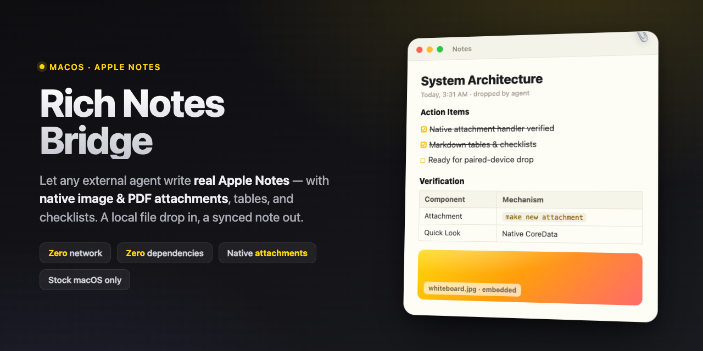

# Rich Notes Bridge

A local, file-based rich bridge for Apple Notes on macOS.

Enables external agents (such as **Muse**) operating over paired-device text channels to create notes in Apple Notes with **true native attachments (images, PDFs, documents)**, rich formatting (tables, checklists, blockquotes, typography), target folder placement, and result reporting — and to **export the full body of an existing note** back out, for connectors whose own Notes read path truncates large notes.

---

## Why This Exists

External agents connected over paired channels often have text-only Apple Notes integrations. macOS Notes automation does not support binary image transfer over simple text AppleScript invocations, and WebKit URL loading inside Notes sandboxing fails on external `file://` URLs.

This bridge solves the limitation by using Apple Notes' native Cocoa scripting attachment handler:
1. The external agent drops a manifest and base64-encoded image/document files into an inbox folder.
2. A background watcher picks up the request and decodes attachments to temporary files in `/tmp`.
3. The bridge invokes Apple Notes automation via AppleScript's native `make new attachment at theNote with data (POSIX file ...)` handler.
4. Notes.app copies the files directly into its internal attachment store. The attachments render inline, support Quick Look, display high-resolution thumbnails, and sync across iCloud.
5. Temporary scratch files in `/tmp` are immediately removed.
6. A result receipt with the new note's CoreData ID is written back to the outbox for the external agent to read.
7. The request is moved to an archive directory to keep the inbox empty and clean.

**Export (reading notes back out)** solves a related but different limitation: some external connectors cap a single note read at 64 KiB, and real notes routinely exceed that. An export request asks the bridge to read a note's full body via the same Notes automation access used for writing, and write it out as two plain files (full plaintext + full HTML) in the outbox — no 64 KiB cap, since the consumer reads the files directly via file transfer rather than through the connector's own truncating read path. Export is strictly read-only: it never creates, modifies, moves, or deletes the note it reads. See [`PROTOCOL.md`](PROTOCOL.md) for the full request/receipt schema.

**Design Constraints:**
- **Stock macOS tools only**: Uses Python 3 standard library and system `osascript`. Zero third-party dependencies or pip packages.
- **Zero network / completely local**: No servers, no network ports, nothing exposed.
- **Deduplication**: Automatically deduplicates by request ID and SHA-256 content hash, preventing duplicate notes if a request is received multiple times.
- **Intermediate file hygiene**: All temporary files are stored strictly under `/tmp` and cleaned up upon note creation.

---

## Directory Layout

By default, the bridge manages:

```
~/.rich-notes-bridge/
├── inbox/     # External agent drops requests here
├── outbox/    # Bridge writes completion results here (receipts, and for
│              # exports also <id>.body.txt / <id>.body.html)
├── archive/   # Processed requests are archived here
├── state/     # Persistent deduplication tracking (dedup.json) — create only,
│              # export requests never touch this
└── logs/      # Service logs (launchd.log, bridge.log)
```

*(Override the base directory anytime via `--dir <path>` or the `RICH_NOTES_BRIDGE_DIR` environment variable).*

---

## Quick Start & Installation

### 1. Run Self-Test
Verify that your Mac's Notes automation is ready. Runs two independent end-to-end tests: creating a note with a real image and rich formatting, and exporting an existing note's full body (including a >100 KB note, verified byte-for-byte against an independently-read oracle):

```bash
./rich_notes_bridge.py test
```

To keep the test note in Notes.app for inspection:
```bash
./rich_notes_bridge.py test --keep
```

### 2. Install as a Background Service (launchd)
Install and activate the LaunchAgent so it runs automatically in your user session:

```bash
./rich_notes_bridge.py install
```

Check service status:
```bash
./rich_notes_bridge.py status
```

To stop or uninstall the LaunchAgent:
```bash
./rich_notes_bridge.py uninstall
```

### 3. Run Manually (Alternative to launchd)
To run the watcher in the foreground:
```bash
./rich_notes_bridge.py run
```

To process the inbox once and exit:
```bash
./rich_notes_bridge.py process
```

---

## External Agent Protocol (Muse)

For the complete specification, see [`PROTOCOL.md`](PROTOCOL.md).

### Single JSON File Drop

Write `~/.rich-notes-bridge/inbox/<request_id>.json`:

```json
{
  "id": "req-20261103-01",
  "title": "System Architecture & Sketches",
  "folder": "Notes",
  "format": "markdown",
  "body": "## System Overview\n\n### Action Items\n- [x] Verified native Apple Notes attachment handler\n- [ ] Ready for Muse paired device drop\n\n### Metrics Table\n| Component | Mechanism | Status |\n|---|---|---|\n| Attachment | `make new attachment with data` | VERIFIED |\n\n> Summary: Real attachments embedded and viewable in Quick Look.\n",
  "attachments": {
    "whiteboard.jpg": "<base64 encoded string>"
  }
}
```

### Multi-File Directory Drop

Create `~/.rich-notes-bridge/inbox/<request_id>/`:
- `manifest.json`: Title, body, target folder.
- `whiteboard.jpg.b64`: Base64 text file of the image.
- `report.pdf.b64`: Base64 text file of a document.

### Reading Results (Outbox)

The bridge writes `~/.rich-notes-bridge/outbox/<request_id>.json`:

```json
{
  "id": "req-20261103-01",
  "status": "success",
  "note_id": "x-coredata://XXXXXXXX-XXXX-XXXX-XXXX-XXXXXXXXXXXX/ICNote/p9450",
  "title": "System Architecture & Sketches",
  "folder": "Notes",
  "attachments_count": 1,
  "attachments": [
    "whiteboard.jpg"
  ],
  "processed_at": "2026-11-04T03:31:31.874177+00:00",
  "error": null
}
```

If the same request is dropped again, the bridge responds with `"status": "duplicate"` and returns the existing `note_id` without creating duplicates in Notes.app.

### Exporting an Existing Note

Write `~/.rich-notes-bridge/inbox/<request_id>.json` with `"op": "export"` instead of dropping a create payload:

```json
{
  "id": "export-pastebin-20261115",
  "op": "export",
  "note_id": "x-coredata://XXXXXXXX-XXXX-XXXX-XXXX-XXXXXXXXXXXX/ICNote/p4304",
  "title": null
}
```

The bridge writes the note's full plaintext and HTML to `outbox/<id>.body.txt` and `outbox/<id>.body.html` (no size cap — read them via file transfer, not the connector's own Notes read path), plus a `outbox/<id>.json` receipt. If `note_id` is `null`, the note is looked up by exact `title` instead — zero matches or more than one match both error out rather than guessing (an ambiguous match lists every candidate note ID in the receipt's `candidates` field). **Export is strictly read-only** (never creates, modifies, or deletes a note) and is **never blocked by the create-dedup mechanism** — re-dropping the same export `id` always re-reads the note fresh, since it may have been edited since the last export. Full schema and error cases: [`PROTOCOL.md`](PROTOCOL.md).

---

## CLI Reference

```
usage: rich_notes_bridge.py [-h] [--dir DIR] [-v] {run,daemon,process,once,install,uninstall,status,test} ...

commands:
  run (daemon)       Run the watcher loop in the foreground
  process (once)     Process pending inbox requests once and exit
  install            Install and load the launchd background agent
  uninstall          Unload and remove the launchd background agent
  status             Show bridge status, queue counts, and launchd health
  test               Run end-to-end self tests (image attachment + export round trip)
```

`--dir`/`-v` work in any position (`rich_notes_bridge.py --dir <path> test` or `rich_notes_bridge.py test --dir <path>` both honor the override).

---

## Security & Privacy

- **100% Offline**: Zero external network access or remote telemetry.
- **Stock Tools Only**: Python standard library + macOS `osascript`.
- **Restricted Permissions**: Default directory permissions created with `0700`.
- **Atomic File Operations**: Uses rename-locking to prevent partial reads or concurrency races.
- **Export is read-only**: An export request can only read a note's existing body — the code path that handles it has no ability to create, edit, move, or delete anything in Notes.app.
